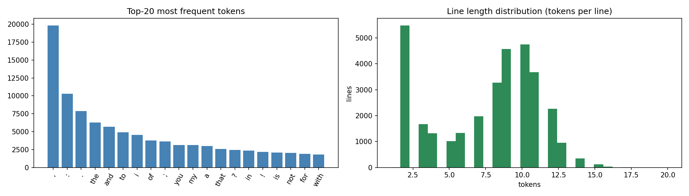
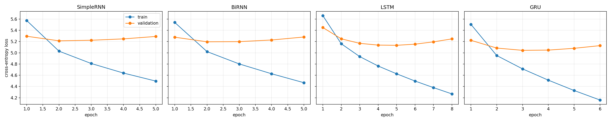
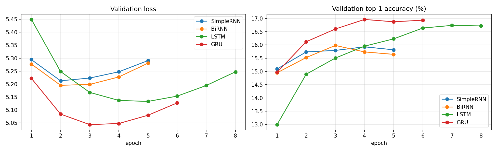
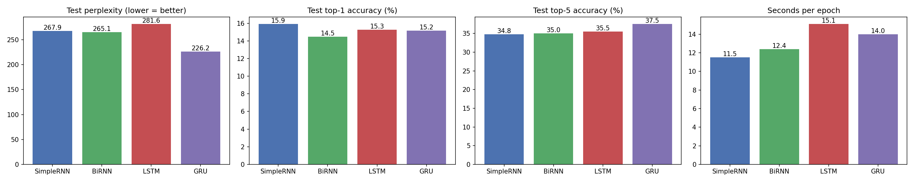
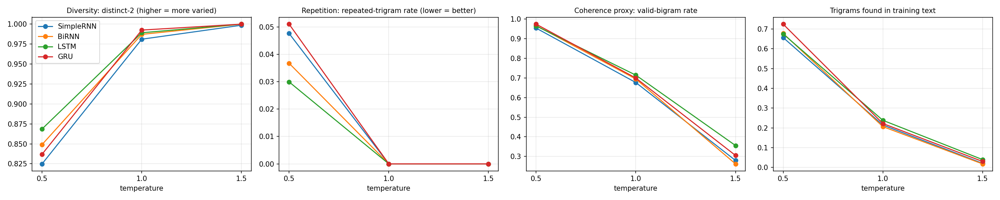

# Autoregressive Next-Word Text Generation with SimpleRNN, Bidirectional RNN, LSTM and GRU

Word-level autoregressive text generation on the Tiny Shakespeare corpus. Four recurrent architectures are trained under identical conditions, compared quantitatively and qualitatively, and used to generate text at three sampling temperatures.

## 1. Problem statement and objective

Build an autoregressive text-generation system that predicts the next word from the previous words, using four recurrent models (Simple RNN, Bidirectional RNN, LSTM, GRU), and:

1. describe and preprocess a text dataset and build input-target sequences for next-word prediction;
2. train and evaluate all four models under comparable conditions (loss, perplexity, accuracy, training time) and assess the generated text (coherence, diversity, contextual consistency, repetition);
3. generate text from the same seeds at three sampling temperatures, analyse the effect of temperature, and justify which model is the most effective generator for this dataset.

## 2. Dataset

**Tiny Shakespeare** (a selection of Shakespeare's plays concatenated into one text file, from Andrej Karpathy's `char-rnn` repository).

- **Source link:** https://raw.githubusercontent.com/karpathy/char-rnn/master/data/tinyshakespeare/input.txt
- Format: dialogue-style plays. A speaker name followed by a colon (for example `First Citizen:`), then the lines that speaker says.

| Property | Value |
|---|---|
| Characters | 1,115,394 |
| Non-empty lines | 32,777 |
| Speaker-turn headers | 7,960 |
| Tokens after preprocessing (words + punctuation) | 250,145 |
| Unique tokens | 12,636 (type-token ratio 0.0505) |
| Tokens appearing only once | 5,704 (45.1% of the vocabulary) |
| Vocabulary used | 5,000 (token coverage 96.17%, `<unk>` rate 3.83%) |

The most frequent tokens are punctuation (`,` `:` `.`) followed by function words (`the`, `and`, `to`, `i`, `of`). Line lengths have a spike at very short lines (speaker headers such as `all :`) and a main mass at about 8-12 tokens.



### Preprocessing

1. Lowercase the text.
2. Split the punctuation marks `. , ! ? ; :` into separate tokens, so the model can learn sentence structure.
3. Remove other special characters and extra whitespace.
4. Tokenize on whitespace (word level).
5. Keep the 4,998 most frequent tokens plus `<pad>` and `<unk>` (5,000 in total). Every other word becomes `<unk>`.

### Input-target sequences

A sliding window of **20 words** is the input and the **next word** is the target (stride 1). The sequences are split **chronologically** 80/10/10 into train/validation/test, with a 20-sequence gap between splits so that windows never overlap across splits. This gives roughly 200,100 training, 24,992 validation and 24,993 test sequences.

## 3. Models implemented

All four models share the same pipeline: `Embedding(5000, 128) -> recurrent layer -> Dropout(0.3) -> Dense(5000, softmax)`. Only the recurrent layer changes.

| Model | Recurrent layer | Parameters |
|---|---|---|
| SimpleRNN | `SimpleRNN(256)` | 2,023,560 |
| BiRNN | `Bidirectional(SimpleRNN(128))` (output width 256) | 1,990,792 |
| LSTM | `LSTM(256)` | 2,319,240 |
| GRU | `GRU(256)` | 2,221,448 |

The bidirectional layer reads only the *window of past words*, forwards and backwards. It never sees future words, so it is valid for next-word prediction.

**Identical training conditions:** the same data and split, random seed (42), Adam (learning rate 1e-3, gradient clipping 1.0), batch size 128, maximum 15 epochs, early stopping on validation loss (patience 3, best weights restored), and sparse categorical cross-entropy loss.

**Generation:** the next word is sampled from the model's softmax output after dividing the log-probabilities by the temperature `T`. `<pad>` and `<unk>` are blocked. The same seed phrases and the same random stream are used for every model, so differences between models are not caused by sampling noise. The random stream differs between seeds and temperatures. Because the seed phrases are shorter than the 20-word window, the first 20 words of the corpus are used as neutral left context.

## 4. Execution steps and dependencies

**Dependencies:** Python 3.10+, `tensorflow>=2.15`, `numpy`, `pandas`, `matplotlib` (see `requirements.txt`).

**Run in Google Colab (recommended):**
1. Open `autoregressive_text_generation.ipynb` in Google Colab.
2. `Runtime -> Change runtime type -> T4 GPU` (all reported results and timings were produced on a Colab T4 GPU).
3. `Runtime -> Run all`. The dataset is downloaded automatically from the source link above.
4. Outputs (tables, plots, generated text) are written to `results/`.

**Run locally:**
```bash
pip install -r requirements.txt
jupyter notebook autoregressive_text_generation.ipynb
```

Training took about 1 to 2 minutes per model (about 5.5 minutes for all four). (see the table below). Results use a single run with seed 42, so small numerical differences are possible on other hardware.

## 5. Results

### 5.1 Predictive performance and training cost

| Model | Epochs run (best) | Train time (s) | s / epoch | Val loss | Test loss | Val perplexity | **Test perplexity** | Test top-1 acc. | Test top-5 acc. |
|---|---|---|---|---|---|---|---|---|---|
| SimpleRNN | 5 (2) | 57.4 | 11.5 | 5.213 | 5.591 | 183.6 | 267.9 | 15.92% | 34.79% |
| BiRNN | 5 (2) | 62.1 | 12.4 | 5.195 | 5.580 | 180.4 | 265.1 | 14.49% | 35.04% |
| LSTM | 8 (5) | 120.9 | 15.1 | 5.133 | 5.640 | 169.5 | 281.6 | 15.28% | 35.50% |
| **GRU** | 6 (3) | 84.3 | 14.0 | **5.044** | **5.422** | **155.0** | **226.2** | 15.18% | **37.52%** |

Perplexity is `exp(loss)` over a 5,000-token vocabulary that includes punctuation and `<unk>`, so it is comparable between the four models here but not with published word-level numbers.





Full tables are in `results/metrics.csv`, `results/summary.csv` and `results/training_histories.json`.

### 5.2 Text-quality metrics by temperature

Each cell is the mean over 15 generated texts of 100 words (3 seeds x 5 runs). The metrics are:
- **distinct-2:** unique bigrams divided by total bigrams (diversity).
- **repeated-trigram rate:** share of trigram occurrences that repeat an earlier trigram in the same text (repetition).
- **valid-bigram rate:** share of generated bigrams that occur in the training text (local coherence proxy).
- **trigram-in-train rate:** share of generated trigrams that occur in the training text (copying versus novelty).

| T | Model | distinct-2 | repeated-trigram rate | valid-bigram rate | trigram-in-train |
|---|---|---|---|---|---|
| 0.5 | SimpleRNN | 0.825 | 0.048 | 0.954 | 0.656 |
| 0.5 | BiRNN | 0.849 | 0.037 | 0.967 | 0.678 |
| 0.5 | LSTM | 0.869 | 0.030 | 0.965 | 0.675 |
| 0.5 | GRU | 0.837 | 0.051 | 0.974 | 0.724 |
| 1.0 | SimpleRNN | 0.981 | 0.000 | 0.677 | 0.214 |
| 1.0 | BiRNN | 0.987 | 0.000 | 0.695 | 0.206 |
| 1.0 | LSTM | 0.989 | 0.000 | 0.714 | 0.238 |
| 1.0 | GRU | 0.993 | 0.000 | 0.700 | 0.222 |
| 1.5 | SimpleRNN | 0.999 | 0.000 | 0.279 | 0.020 |
| 1.5 | BiRNN | 1.000 | 0.000 | 0.262 | 0.018 |
| 1.5 | LSTM | 1.000 | 0.000 | 0.356 | 0.039 |
| 1.5 | GRU | 1.000 | 0.000 | 0.305 | 0.030 |



Per-text values are in `results/generation_metrics_raw.csv`, and all 36 samples (4 models x 3 seeds x 3 temperatures) are in `results/generated_samples.txt`.

### 5.3 Sample outputs

Seed: `my lord, i do beseech you to` (the text after `||` is generated).

**T = 0.5**
```
[SimpleRNN] || morrow, and i will be not, they have into my father's blood. i am a matter. first murderer: i pray, this, i pray not to but in my name. menenius: and
[BiRNN    ] || clarence. queen elizabeth: i thank you, i say to morrow, we am, and you know you, makes you, for this, come, i'll see but i am so. menenius: i
[LSTM     ] || the world. third citizen: marry, they have not deserved; for we are not to you. first murderer: i pray you, good sir, i'll to the point. coriolanus: i would not
[GRU      ] || the world. third servingman: marry, they have made a very matter. menenius: i will not a man, you shall not be, for you are to the common. coriolanus: i would not
```

**T = 1.0**
```
[SimpleRNN] || clarence: which! good news? valiant uncle capulet: haply prince thou unhappy again. lieutenant is: then my shoulder is held a way. this, he an you must the county strokes, that thou
[BiRNN    ] || clarence: which! good news? lady marshal: then, prince thou unhappy that shall thy hate. then my shoulder is me; and else forth, he an you must the rich strokes, that thou
[LSTM     ] || the crown. king richard ii: valiant uncle, then, prince edward, that shall thy title excels thy my shoulder branch on him and else this, he an you must sat ourselves. 'tis that duty
[GRU      ] || the crown. king richard ii: valiant uncle, too lancaster, thou unhappy that shall thy title. then my shoulder branch therein borne and else this, he an true folly, and strokes in my duty
```

**T = 1.5**
```
[SimpleRNN] || keys i shine, deeper more mould wont for some dislike to leave a ale must look it springs at right my brother's paris champion; think to wild same kindly when boldly, lost all shalt deep see ago
[BiRNN    ] || keys i shine to deeper content, wont for some news to leave a hundred always look it give at right banishment and paris champion discourse before to wild public fiend when boldly trumpet lost as shalt deep see ago
[LSTM     ] || keys i shine, should content a wont for some news to leave a hundred livery look it framed at right banishment and paris, we think to wild same kindly when boldly bade us all shalt pay see a
[GRU      ] || keys i shine, deeper more mould wont for some news to leave a hundred form look it framed at right my brother's paris champion; tear up hence from their blood boldly, had as much deep breaths ago
```

## 6. Model comparison and evaluation

**Predictive quality.** GRU is the clear leader. Its validation perplexity (155.0) is about 9% lower than the next best model (LSTM, 169.5), and its test perplexity (226.2) is about 15% lower than the next best (BiRNN, 265.1). It also has the highest top-5 accuracy (37.5% against 34.8-35.5%). SimpleRNN, BiRNN and LSTM are close on test perplexity (265-282), and their order changes between validation and test (LSTM is second on validation but last on test), so with a single training run their relative order should not be over-interpreted. Top-1 accuracy barely separates the models (14.5-15.9%), because many continuations are plausible for any context. Perplexity and top-5 accuracy are more informative.

**Training behaviour.** Every model overfits quickly: validation loss is lowest at epoch 2 (SimpleRNN, BiRNN), 3 (GRU) and 5 (LSTM), and then rises while training loss keeps falling. The gap between training and validation loss at the best epoch is largest for LSTM (0.51) and GRU (0.33), and smallest for SimpleRNN and BiRNN (0.17-0.18). The gated models learn more from the data and reach lower validation loss, but also memorise faster. A small 250k-token corpus with a 5,000-word output layer makes overfitting unavoidable without stronger regularisation.

**Cost.** SimpleRNN is fastest (11.5 s/epoch), BiRNN next (12.4), then GRU (14.0) and LSTM (15.1). In total training time GRU (84 s) was much cheaper than LSTM (121 s) because it reached its best validation loss earlier. GRU therefore gives the best accuracy per unit of compute among the gated models.

**Bidirectional layer.** The bidirectional SimpleRNN performed within noise of the plain SimpleRNN (test perplexity 265.1 against 267.9, top-1 accuracy lower). Reading the 20-word context backwards gives no clear benefit for next-word prediction here.

**Test versus validation.** Test perplexity is higher than validation perplexity for every model (for example 226 against 155 for GRU). The split is chronological, so the test set is the last 10% of the corpus, which is probably different plays with different names and vocabulary. This is the most likely cause, though it was not tested directly.

**Generated text.** At moderate temperatures all four models reproduce the format of the plays (speaker labels such as `menenius:` and `coriolanus:`, short grammatical phrases like `i am a man`, `good sir`) but not global meaning: sentences wander and characters from different plays appear together (for example `polixenes` and `brutus` in the same passage). The seed influences only the first few words. Even so, there are signs of contextual consistency: after the seed `my lord, i do beseech you to`, both LSTM and GRU at T = 1.0 continue with `the crown. king richard ii: valiant uncle`, a topically linked royal-court context. Character names from the Coriolanus opening (used as neutral left context) appear very often, so that context probably biases the generation slightly.

## 7. Sampling-temperature analysis

**T = 0.5 (conservative).** Text is the most locally coherent (valid-bigram rate 0.95-0.97, and 0.65-0.72 of trigrams are copied from the training text) but the least diverse (distinct-2 0.82-0.87) and the only setting with noticeable repetition (repeated-trigram rate 0.03-0.05). It falls into frequent patterns such as `i am a man`, `i would not`, `i have not` and repeated speaker tags, and it reuses phrases from the training data.

**T = 1.0 (balanced).** Repetition disappears (0.000 for all models), diversity is high (distinct-2 0.98-0.99), and about 0.68-0.71 of bigrams are still valid training bigrams. Text is varied and keeps Shakespearean vocabulary, but grammar and sense are frequently broken (`how we hath so so now`). This is the best compromise between diversity and coherence. The differences between models at T = 1.0 are small, comparable to the run-to-run standard error (about 0.01-0.016).

**T = 1.5 (random).** Diversity saturates (distinct-2 about 1.0) but coherence collapses: only 0.26-0.36 of bigrams and 0.02-0.04 of trigrams occur in the training text, and the output is a list of loosely related, often rare words (`keys i shine, deeper more mould wont for some dislike`). Repetition is zero because the distribution is almost flat.

**Overall effect.** Raising the temperature trades coherence for diversity monotonically. Repetition is a low-temperature problem only, while incoherence is a high-temperature problem, so a middle value around T = 1.0 is the most useful. Models differ in how they respond to temperature:
- At low T, GRU is the most coherent (valid-bigram 0.974, trigram-in-train 0.724) but also the most repetitive (0.051) and the one that copies most from the training set. LSTM is the most diverse and least repetitive (distinct-2 0.869, repetition 0.030).
- At T = 1.0 the models are close; GRU has the highest diversity (0.993) and LSTM the highest valid-bigram rate (0.714).
- At T = 1.5, LSTM stays the most coherent (valid-bigram 0.356, against 0.262-0.305 for the others), so it degrades most gracefully at high temperature.

## 8. Conclusion: best-performing model

**GRU is the best model for autoregressive generation on this dataset.** It has the lowest validation and test perplexity (155.0 and 226.2), the highest top-5 accuracy (37.5%), and the best local coherence at low temperature, and it reaches its best validation loss in fewer epochs than the LSTM, at about 30% less total training time. At T = 1.0 its generations are as good as any other model's and it has the highest diversity. LSTM is the runner-up: it is the most diverse and least repetitive at T = 0.5 and stays the most coherent at high temperature, but it has the worst test perplexity, the largest overfitting gap and the longest training time. SimpleRNN and BiRNN are the cheapest but have higher perplexity, and the bidirectional layer gave no benefit for next-word prediction.

**Limitations.** Each model was trained once (seed 42), so the small differences among SimpleRNN, BiRNN and LSTM are not conclusive. Only GRU's perplexity advantage is large. The corpus is small (250k tokens), all models overfit after 2-5 epochs, and the vocabulary is capped at 5,000 words (3.8% `<unk>`). The text metrics (valid-bigram rate and so on) are proxies for coherence, not human judgement, and are based on 15 texts per model and temperature. The chronological test split probably contains different plays from the training set.

## 9. Repository structure

```
.
├── README.md
├── requirements.txt
├── autoregressive_text_generation.ipynb
├── data/                 # tinyshakespeare.txt is downloaded by the notebook
└── results/
    ├── metrics.csv
    ├── summary.csv
    ├── training_histories.json
    ├── generation_metrics_summary.csv
    ├── generation_metrics_raw.csv
    ├── generated_samples.txt
    ├── dataset_characteristics.png
    ├── loss_curves.png
    ├── validation_comparison.png
    ├── metric_bars.png
    └── temperature_analysis.png
```

## 10. Dataset credit

Tiny Shakespeare, from Andrej Karpathy's `char-rnn` repository: https://github.com/karpathy/char-rnn (raw file linked above).
